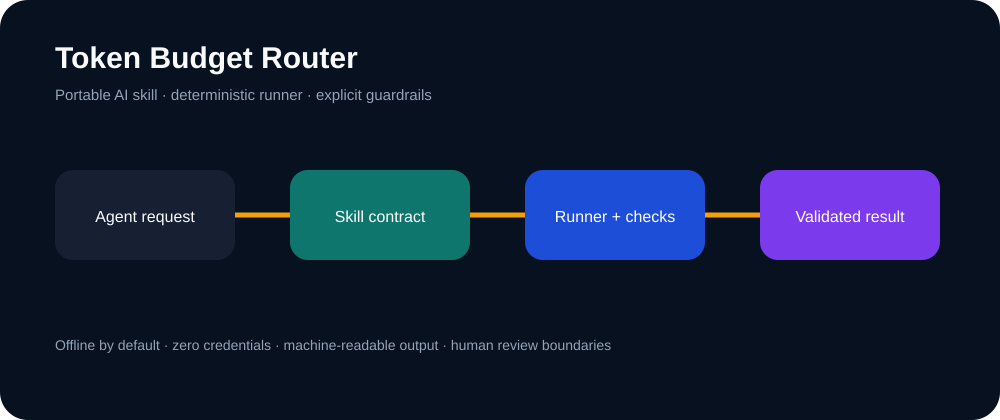

# Token Budget Router

> Agent stacks overspend by routing every step to a frontier model without measuring task complexity.

Provider-neutral AI skill for Claude Code, Codex, ChatGPT, Claude, Gemini, Grok and custom agent runtimes. It combines concise agent instructions with a deterministic Python execution path.

## What it does

Route AI tasks across model classes and context strategies using explicit quality, latency, privacy and token-cost constraints. Use when an agent system needs a deterministic model-selection plan instead of always choosing the largest model.

## Architecture

```text
User/Agent → SKILL.md → input contract → deterministic runner → validated JSON result
```

## Install

Copy `skill/` into your agent's skills directory, or reference `skill/SKILL.md` from an agent configuration. No API key or network access is required.

## Demo

```bash
python skill/scripts/run.py examples/input.json --mode router
pytest -q
```



## Compatibility

| Runtime | Method |
|---|---|
| Codex / ChatGPT | Install or reference `skill/` |
| Claude Code | Add `skill/SKILL.md` to project instructions or a command wrapper |
| Gemini / Grok | Supply `SKILL.md` as system/project context and expose the runner as a tool |
| MCP agents | Wrap the runner as a stdio tool with the documented JSON contract |

## Safety

See [SECURITY.md](SECURITY.md) and [docs/GUARDRAILS.md](docs/GUARDRAILS.md). The skill does not bypass access controls or transmit input data.
